# Screenshots

These images are captures of the real `App` and `MainWindow`, rendered by Avalonia Headless with Skia. They have no operating-system window frame and do not show native file dialogs, popups, desktop integration or screen-reader behaviour.

The capture tool creates the same sample trip that **Explore a sample trip** offers in the application ("Spring in Japan", fixed to May 2027 for repeatable images) and an empty "Weekend in Aachen" trip. Place names are real; times, bookings, references and prices are invented. Everything is written to a temporary directory with its own settings and Git configuration and removed afterwards. No network service is contacted; the map shows the offline view with its opt-in prompt, and the weather comes from a built-in synthetic service with invented values, seen the evening before the plan's first day.

## Regenerate

From the Jourfold repository, with .NET SDK 10.0.401, Git 2.34 or newer and the sibling TravelRepo checkout:

```sh
dotnet restore eng/Screenshots/Screenshots.csproj --locked-mode
dotnet run --project eng/Screenshots -c Release --no-restore -- docs/screenshots
```

This writes the fourteen images below, at 1440 × 900 pixels except the document window at 1100 × 820. Two options help when checking changes:

- `--all` adds every main view, dialogs (palette, schedule editor, share, Create Version, new trip, the open-source notices, Connect an AI assistant, the export dialog for a plan and for packing lists, deleting a linked stay, a Git problem with its fix, accommodation details and the reminders, weather settings, What's new and the version history), variants with comparison and conflict resolution, plus `itinerary.pdf`, `itinerary-full.pdf` (every part and the map), `packing-lists.pdf` and `itinerary.html`. Use it with a scratch directory, not `docs/screenshots`.
- `--lang de` captures the German interface.

Open the images and check text, clipping, theme and selection before committing them. Do not edit or retouch captures.

## Captures

The timetable with the Inbox and the inspector, in light and dark themes. Stays are the band of nights at the bottom:

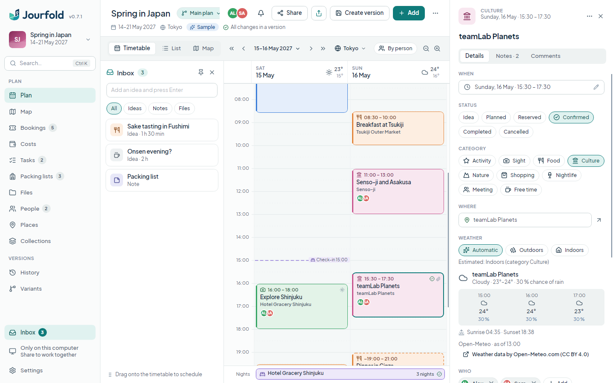

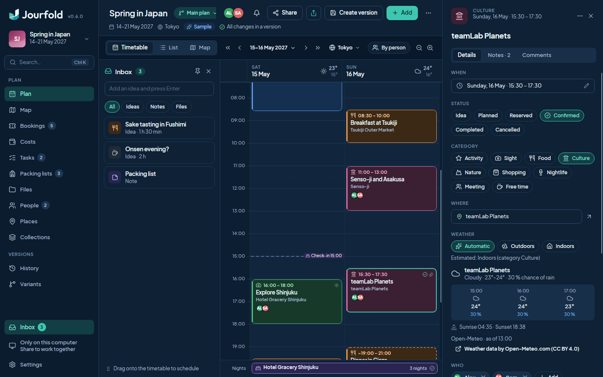

The trip library:

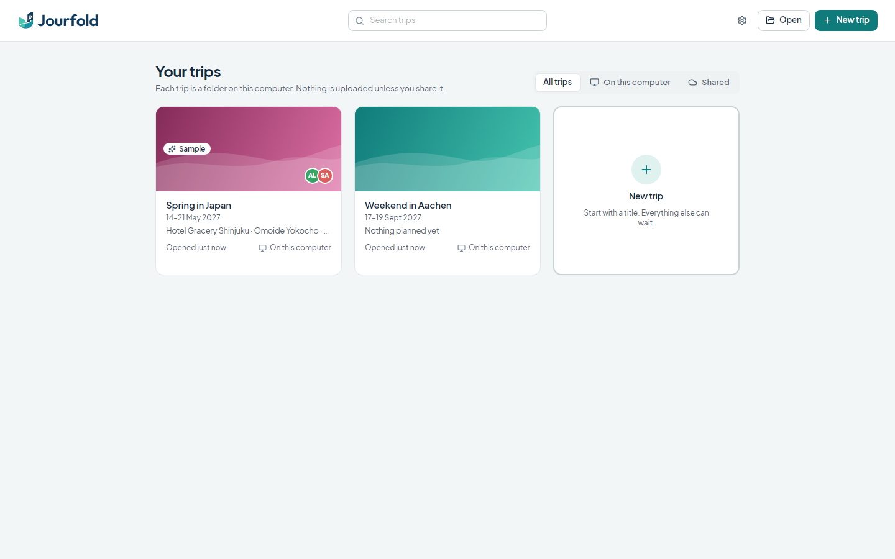

The day-by-day list:

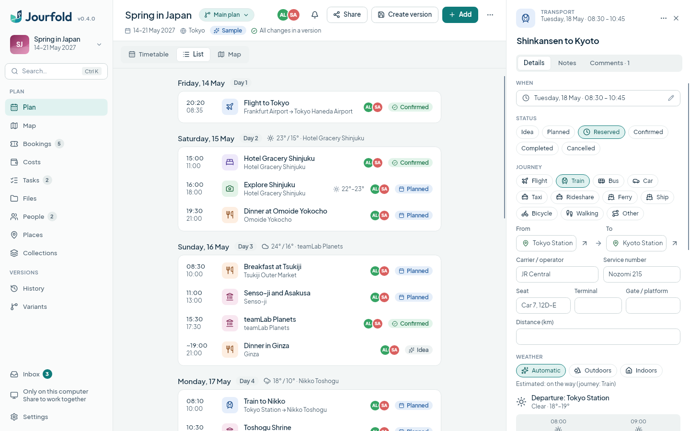

The map before online maps are enabled. Places and routes come from the trip's own coordinates:

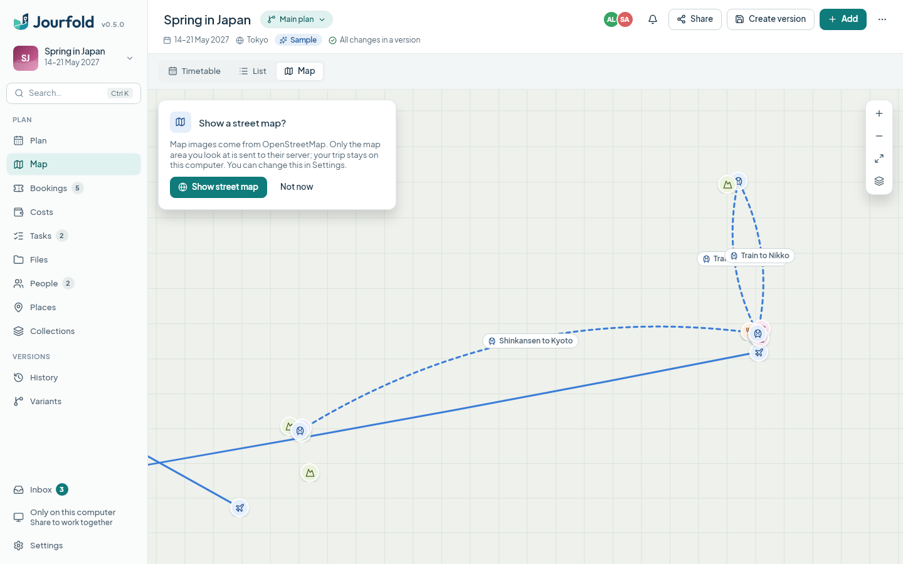

Costs per currency with budgets:

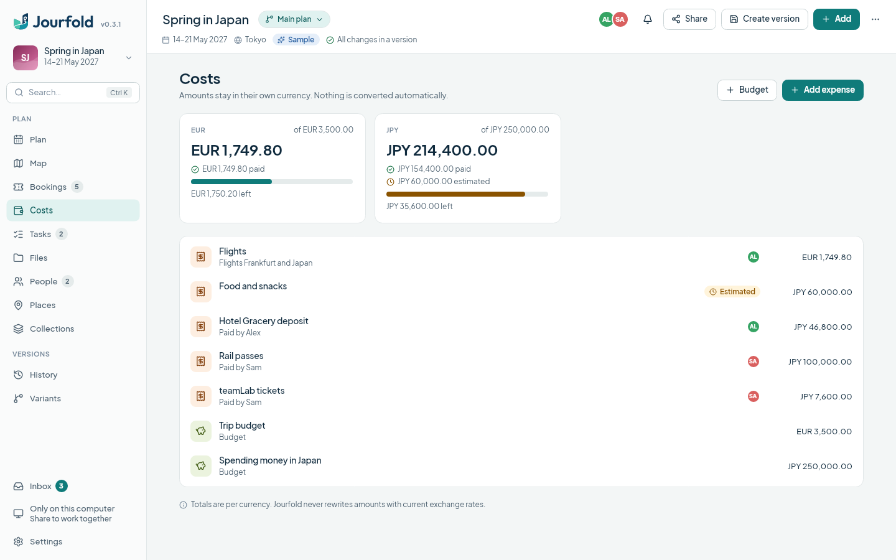

A packing list with groups, who brings what, what each person has packed, and one item nobody has taken yet:

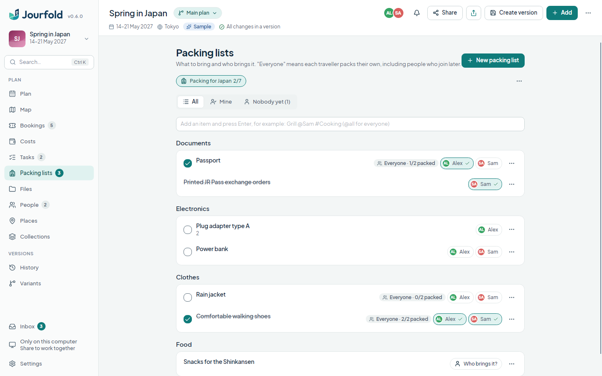

A booking with its confirmation e-mail attached, and the drop area for more:

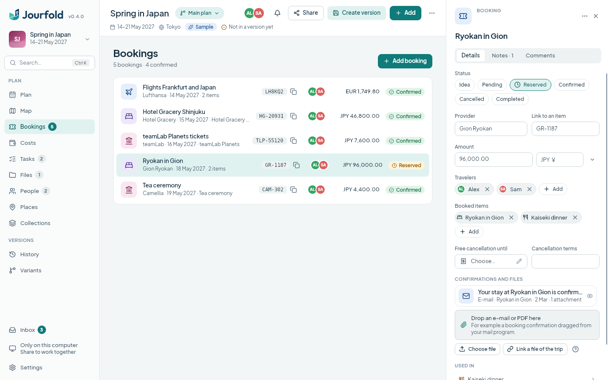

The document window with the confirmation e-mail and with its PDF attachment, searched for a time:

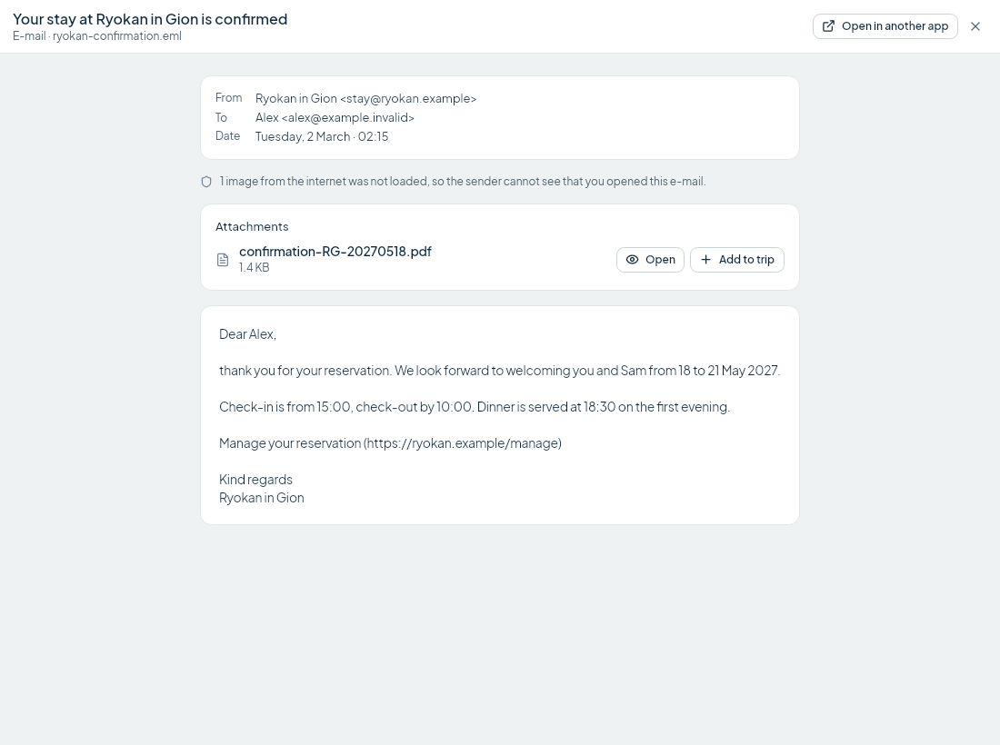

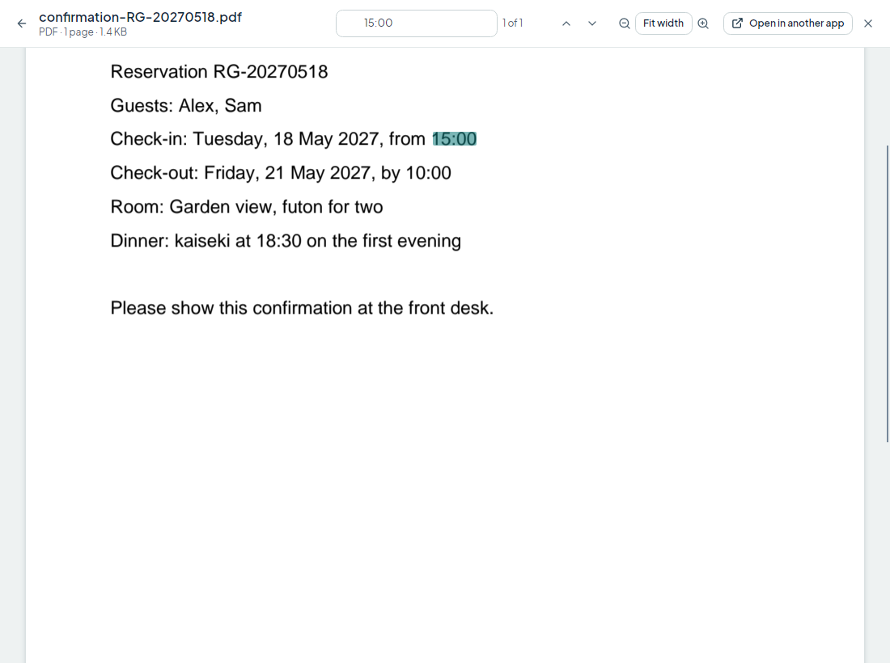

The weather of an outdoor activity with rain in the forecast, and the day forecasts above the timetable:

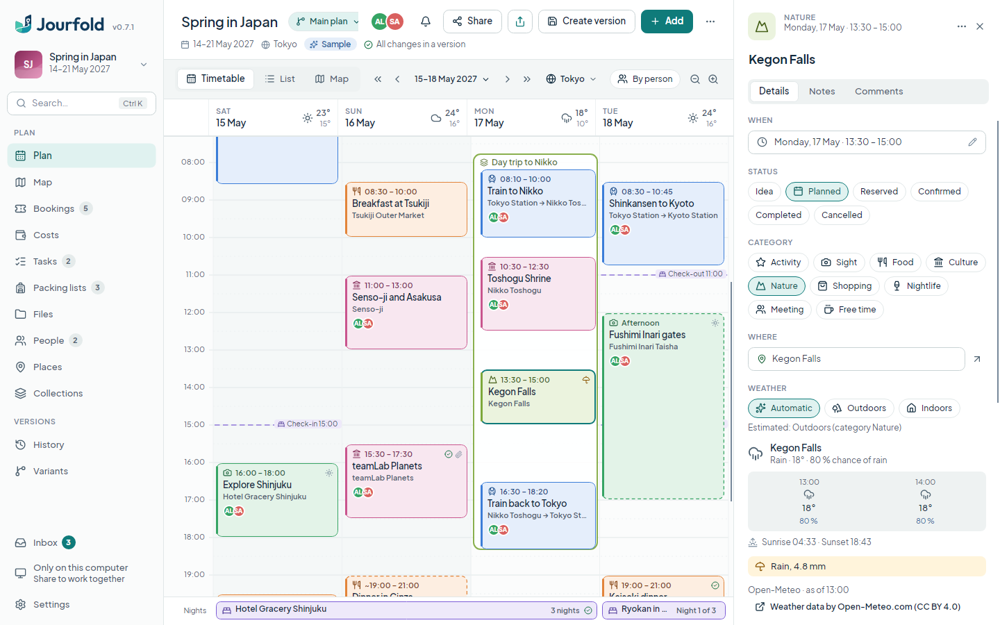

Quick Add:

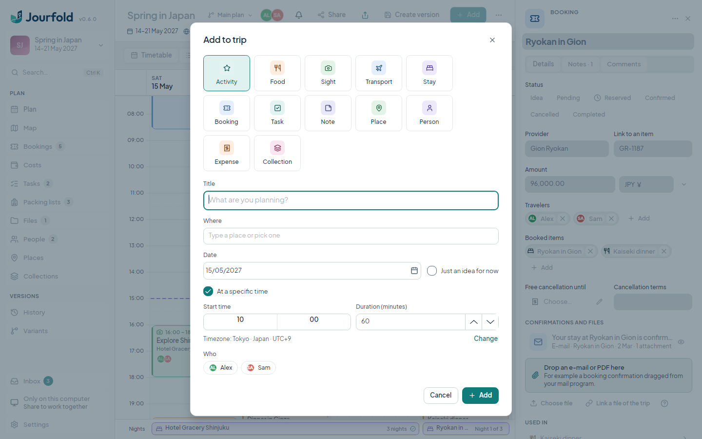

Settings:

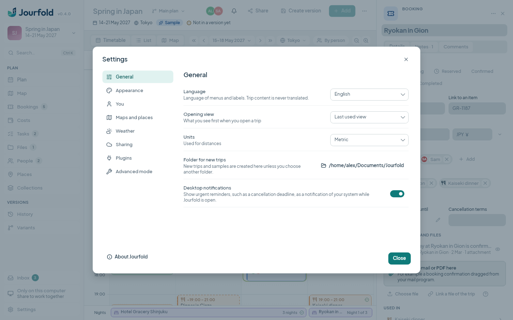

About Jourfold, with the example plugin loaded:

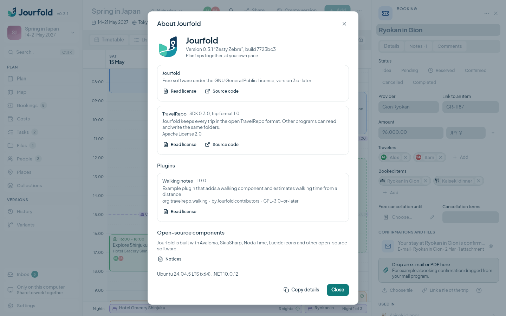
